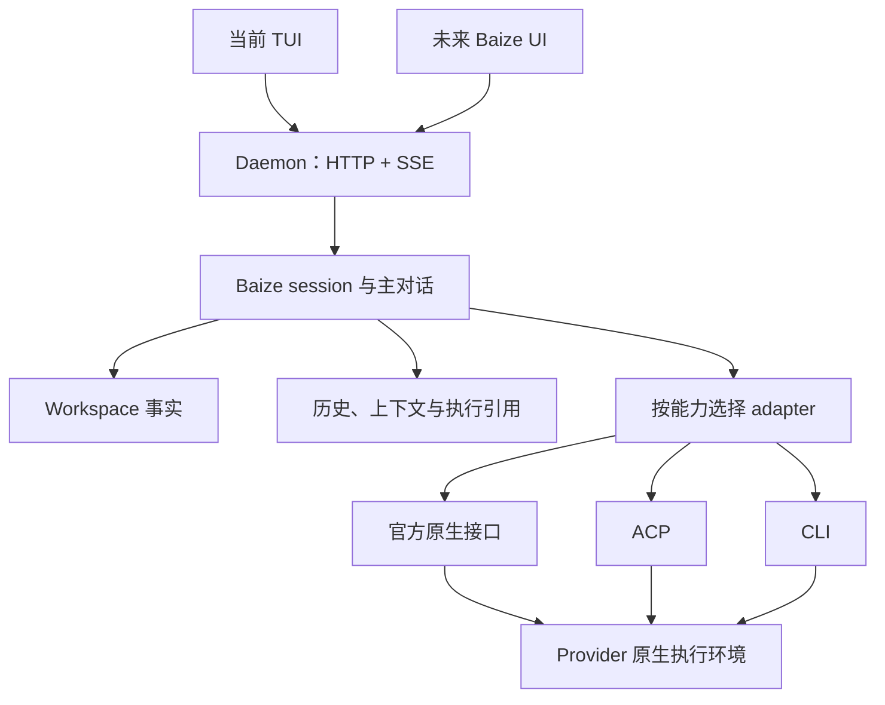

# Baize Technical Spec

Version: 0.1.0
Status: product-aligned target design, updated 2026-11-21

本文中的接口与模型草案描述目标设计，不是当前 API 或能力清单。已实现路径与待验证项见 [MVP 计划](mvp-implementation-plan.md)。

## 1. 目标

实现持续的 Baize session：保持同一用户主对话和 workspace，切换实际执行 agent 时组合当前工作区、近期相关对话与有效约束，尽可能保留目标环境的原生能力。

技术方向保持 Rust core、local daemon、SQLite 与薄客户端。当前 UI 为 ratatui TUI；未来 Baize 自身 Desktop UI 与 provider Desktop 执行接入分别设计。接入协议按能力选择，不把 ACP 或 CLI 作为固定产品边界。

## 2. 总体架构

Baize 采用 headless daemon + thin client 架构。



图中的三个接入路径不保证获得相同能力。Provider Desktop 环境只有在相应接口、配置与原生工具实际可用时才算接入。

核心约束：

- UI 不直接调用 agent；daemon 持有 Baize session、主对话、执行引用与切换状态；
- agent 切换不创建新的上层 session，不要求用户复制近期讨论；
- Baize session 与 provider 原生 session 分离，内部历史不依赖某一家的存档格式；
- 当前 workspace 与近期相关原始对话共同构成接续输入，摘要按需补充；
- 原生 prompt、MCP、skills、computer use、browser use 的支持按执行入口验证；
- provider Desktop 的能力接入与 Baize 自身的窗口或技术栈无必然绑定；
- 重要输入、输出、切换和已知执行结果关联回同一 session；未知结果不假装已完成；
- 不静默降级到较低能力入口，不复制厂商内部进程或工具状态来伪造连续性。

## 3. Rust Workspace

建议目录：

```text
apps/
  desktop/
crates/
  baize-core/
  baize-daemon/
  baize-tui/
  baize-acp/
  baize-adapters/
  baize-workspace/
  baize-storage/
  baize-config/
  baize-cli/
doc/
```

### 3.1 `baize-core`

核心领域模型和纯业务逻辑。

包含：

- `WorkspaceId`
- `TaskSessionId`
- `ProviderId`
- `AgentRunId`
- `TaskSession`
- `ProviderProfile`
- `ProviderHealth`
- `QuotaState`
- `RouteDecision`
- `HandoffSummary`
- `PermissionRequest`
- `CommandPolicy`
- routing policy trait
- handoff policy trait

不包含：

- SQLite 细节；
- HTTP server；
- terminal UI；
- provider subprocess；
- git command 执行。

### 3.2 `baize-daemon`

本地 headless kernel。

包含：

- daemon lifecycle；
- local API；
- event stream；
- service wiring；
- provider process lifecycle；
- task session orchestration；
- route execution；
- handoff execution；
- permission prompt coordination。

### 3.3 `baize-tui`

当前版本的薄 UI，用于验证 Baize session 连续性。主对话跨 provider 切换保持，agent 和执行入口需要可辨认；TUI 不代表 CLI 与 provider Desktop 能力等效。

包含：

- workspace selector；
- task session list；
- prompt input；
- agent stream viewer；
- route decision panel；
- provider health/quota panel；
- changed files panel；
- command/test result panel；
- permission prompt modal；
- handoff preview。

TUI 只调用 daemon API，不直接读写 workspace，也不直接启动 agent。

### 3.4 `baize-acp`

ACP 协议能力层。下面是目标职责；当前 MVP 只有消息原语与初始化验证，不代表完整 lifecycle 已实现。

包含：

- stdio transport；
- JSON-RPC framing；
- initialize/auth/session lifecycle；
- prompt request；
- session updates；
- permission callbacks；
- file/terminal client capabilities；
- capability mapping；
- protocol error normalization。

第一版只实现 Baize MVP 所需 ACP 子集，避免一次性追完整协议。

### 3.5 `baize-adapters`

provider adapter 实现。

当前 CLI 执行基线为 Codex、Antigravity、OpenCode；Copilot 等能力以实际验证范围记录。

Adapter 可以使用官方原生服务/RPC/SDK、ACP 或 CLI。优先选择能保留用户所需原生能力的支持接口；ACP 满足需求时复用标准协议；CLI 用于兼容执行，不静默替代声明的 Desktop 环境。

能力描述应区分 provider 身份、执行入口、transport、profile/配置范围，以及已验证、未验证、不支持的能力。覆盖内置 prompt、项目指令、MCP、skills、computer/browser use、session/resume、消息/状态回流和权限交互。

同一 provider 的多个入口不应只按品牌共用能力结论。Shared configuration 的映射属于 adapter 能力，不能用统一提示词覆盖目标 agent 原生机制。

### 3.6 `baize-workspace`

workspace state tracking。

包含：

- git root detection；
- branch/status detection；
- dirty state；
- changed files；
- diff summary；
- command execution wrapper；
- test script detection；
- checkpoint hooks；
- file snapshot references；
- hunk attribution helper。

### 3.7 `baize-storage`

SQLite 和本地文件存储。

包含：

- database schema；
- migrations；
- event log；
- repositories；
- file artifact store；
- transcript references；
- handoff artifact store；
- checkpoint references。

### 3.8 `baize-config`

TOML 配置。

包含：

- global config；
- workspace config；
- provider profiles；
- 通用用户要求与已有项目配置来源；
- 按执行入口声明的配置映射、支持项和未支持项（目标能力，当前未实现）；
- route policy；
- command policy；
- checkpoint policy；
- path normalization；
- config validation。

### 3.9 `baize-cli`

命令入口。

命令建议：

```text
baize
baize tui
baize daemon
baize status
baize doctor
baize config
baize providers
baize sessions
```

## 4. Workspace And Project

Baize 需要区分 `workspace` 和文件系统上的 `project`。

建议定义：

```text
Project:
  文件系统上的代码项目根。
  通常是一个 git repo root，也可能是 monorepo 中的一个 package/app 目录。

Workspace:
  Baize 对一个或多个 project 的操作上下文。
  包含 session、provider、routing、policy、event log、handoff、checkpoint、UI state。
```

### 4.1 为什么要区分

如果把 workspace 直接等同于 repo path，MVP 会简单，但长期会卡住：

- monorepo 中用户可能只想让 agent 操作某个 package；
- 一个任务可能跨多个 repo，例如 frontend + backend；
- 同一个 repo 可能有多个 Baize 工作上下文，例如不同 branch、不同 policy、不同 provider profile；
- Windows/WSL 下，同一个 project 可能有 Windows path 和 WSL path 两种表示；
- agent 的 cwd、git root、permission boundary、Baize session boundary 不总是同一个东西。

### 4.2 MVP 关系

MVP 中采用简化关系：

```text
1 workspace = 1 project = 1 git repo root or selected directory
```

但数据模型保留扩展空间：

```rust
struct Workspace {
    id: WorkspaceId,
    name: String,
    primary_project_id: ProjectId,
    policy_profile_id: PolicyProfileId,
    created_at: DateTime,
    updated_at: DateTime,
}

struct Project {
    id: ProjectId,
    workspace_id: WorkspaceId,
    root: PathBuf,
    kind: ProjectKind,
    vcs: VcsKind,
    trust_level: TrustLevel,
    created_at: DateTime,
    updated_at: DateTime,
}
```

### 4.3 Project Root

`project.root` 是 agent 实际操作文件系统时的默认边界。

它用于：

- provider cwd；
- git status/diff；
- command execution working directory；
- permission boundary；
- file watch；
- checkpoint；
- transcript/path references。

### 4.4 Workspace Root

`workspace` 不一定对应一个真实目录。它是 Baize 的逻辑容器。

它用于：

- task sessions；
- provider sessions；
- route decisions；
- handoff summaries；
- event log；
- UI state；
- user policy；
- project membership。

### 4.5 Permission Boundary

默认权限边界是：

```text
project.root
```

未来支持多 project workspace 时，权限边界可以是：

```text
allowed_roots = [project_a.root, project_b.root]
```

写入 allowed roots 外部路径必须确认或拒绝。

### 4.6 命名建议

用户界面可以优先使用 `workspace`，因为用户是在 Baize 中进入一个工作上下文。

技术层面必须保留 `project`，因为 agent、git、shell、filesystem 操作都需要具体 root path。

因此：

```text
用户看到：Workspace
系统建模：Workspace has Project(s)
MVP 实现：Workspace has exactly one Project
```

## 5. Local API

MVP 推荐：

```text
HTTP JSON API
+ SSE event stream
```

原因：

- TUI 和 future desktop 都容易接入；
- 调试简单；
- 不绑定 UI 技术；
- 可逐步扩展为 WebSocket 或 JSON-RPC。

### 5.1 API 草案

```text
GET  /health
GET  /workspaces
POST /workspaces
GET  /workspaces/:id/status

GET  /providers
GET  /providers/:id/health
POST /providers/:id/check

GET  /sessions
POST /sessions
GET  /sessions/:id
POST /sessions/:id/prompt
POST /sessions/:id/cancel
POST /sessions/:id/handoff

GET  /sessions/:id/events
GET  /sessions/:id/diff
GET  /sessions/:id/handoff/:handoff_id

POST /permissions/:id/approve
POST /permissions/:id/deny
```

### 5.2 Event Stream

事件通过 SSE 推给 TUI。

事件类型：

```text
workspace.status.changed
provider.health.changed
provider.quota.changed
session.created
session.route.decided
session.agent.started
session.agent.output
session.agent.tool_call
session.agent.completed
session.agent.failed
workspace.diff.changed
command.started
command.output
command.completed
permission.requested
permission.resolved
handoff.created
handoff.accepted
handoff.failed
```

每个事件都应包含：

```text
event_id
timestamp
workspace_id
session_id optional
provider_id optional
payload
```

## 6. Core Data Model

### 6.1 Workspace

```rust
struct Workspace {
    id: WorkspaceId,
    name: String,
    primary_project_id: ProjectId,
    created_at: DateTime,
    updated_at: DateTime,
}
```

### 6.2 Project

```rust
struct Project {
    id: ProjectId,
    workspace_id: WorkspaceId,
    root: PathBuf,
    kind: ProjectKind,
    vcs: VcsKind,
    active_branch: Option<String>,
    trust_level: TrustLevel,
    created_at: DateTime,
    updated_at: DateTime,
}
```

### 6.3 Task Session

```rust
struct TaskSession {
    id: TaskSessionId,
    workspace_id: WorkspaceId,
    objective: String,
    active_provider_id: Option<ProviderId>,
    provider_native_session_ids: BTreeMap<String, String>,
    status: TaskSessionStatus,
    stickiness: StickyPolicy,
    created_at: DateTime,
    updated_at: DateTime,
}
```

`TaskSession` 是用户工作的稳定身份，agent 切换只改变下层执行引用，主对话和 workspace 仍归原 session。上述模型是设计示意，`stickiness` 等字段以当前代码为准。

当前代码按 provider ID 保存原生 session ID。支持多 profile、不同执行入口或多个原生会话时，引用身份需要进一步区分；不能把当前映射当成完整 Desktop 会话模型。

### 6.4 Provider Profile

```rust
struct ProviderProfile {
    id: ProviderId,
    kind: ProviderKind,
    display_name: String,
    priority: u32,
    transports: Vec<ProviderTransport>,
    capabilities: ProviderCapabilities,
    enabled: bool,
}
```

### 6.5 Provider Health

```rust
struct ProviderHealth {
    provider_id: ProviderId,
    status: HealthStatus,
    latency_ms: Option<u64>,
    last_error: Option<String>,
    checked_at: DateTime,
}
```

### 6.6 Quota State

```rust
struct QuotaState {
    provider_id: ProviderId,
    remaining_percent: Option<f32>,
    reset_eta_seconds: Option<u64>,
    confidence: QuotaConfidence,
    source: QuotaSource,
    observed_at: DateTime,
}
```

### 6.7 Route Decision

```rust
struct RouteDecision {
    id: RouteDecisionId,
    session_id: TaskSessionId,
    selected_provider_id: ProviderId,
    previous_provider_id: Option<ProviderId>,
    reason: String,
    confidence: f32,
    mode: RoutingMode,
    created_at: DateTime,
}
```

### 6.8 Handoff Summary

```rust
struct HandoffSummary {
    id: HandoffId,
    session_id: TaskSessionId,
    from_provider_id: ProviderId,
    to_provider_id: ProviderId,
    summary_markdown: String,
    mechanical_facts: HandoffFacts,
    status: HandoffStatus,
    created_at: DateTime,
}
```

## 7. Adapter Interface

Adapter trait 草案：

```rust
#[async_trait]
trait AgentProvider {
    fn id(&self) -> ProviderId;
    fn capabilities(&self) -> ProviderCapabilities;

    async fn health(&self) -> Result<ProviderHealth>;
    async fn quota(&self) -> Result<QuotaState>;

    async fn start_session(
        &self,
        input: StartSessionInput,
    ) -> Result<ProviderSessionRef>;

    async fn resume_session(
        &self,
        session_ref: ProviderSessionRef,
    ) -> Result<ProviderSessionHandle>;

    async fn prompt(
        &self,
        handle: ProviderSessionHandle,
        input: PromptInput,
    ) -> Result<AgentRunStream>;

    async fn request_handoff(
        &self,
        handle: ProviderSessionHandle,
        input: HandoffRequest,
    ) -> Result<HandoffDraft>;

    async fn cancel(
        &self,
        handle: ProviderSessionHandle,
    ) -> Result<()>;
}
```

Provider session reference 必须可序列化，用于恢复或关联实际执行入口。下面是设计草案，不表示当前 adapter 已实现所有接口：

```rust
struct ProviderSessionRef {
    provider_id: ProviderId,
    transport: ProviderTransportKind,
    external_session_id: Option<String>,
    resume_command: Option<Vec<String>>,
    transcript_path: Option<PathBuf>,
    checkpoint_ref: Option<String>,
    metadata: JsonValue,
}
```

原生引用应能识别执行入口与配置身份，并记录目标已接收上下文的位置。具体字段与存储迁移在实现时确定。Baize 主对话属于上层 session；原生引用不提供跨厂商工具状态迁移。

## 8. Routing

路由支持会话连续性，使用规则与用户显式选择：

1. 用户指定执行者时检查所选入口是否可用、能否满足所需能力。
2. 未要求切换且当前执行者可用时，优先继续。
3. health、额度或失败可以产生建议；用户也可因能力、效果或不同模型/prompt 主动切换。
4. 在可确认的回合边界准备交接，记录原因、目标入口和能力缺口。
5. 按 manual/assisted 授权执行，不静默切换到缺少关键工具的入口。
6. 目标接续结果与主对话仍关联原 Baize session；失败保留该 session 与已知状态。

连续性验收不依赖精确额度或基于任务类型的自动性能判断。Autopilot 不进入当前闭环前提。

## 9. 上下文与 Handoff Pipeline

交接输入为当前 workspace + 近期相关对话 + 有效约束，必要时追加摘要。

### 9.1 上下文选择

| 情况 | 处理 |
|---|---|
| 同 provider 且原生 session 可续接 | 复用原生历史，避免重复注入；workspace 状态仍需检查 |
| 目标没有原生 session | 为新下层会话提供相关上下文，保留同一 Baize session |
| 切换或切回旧 provider | 在目标原生历史基础上补充其尚未知晓的相关增量 |
| 目标不支持 resume | 从 Baize 对话与 workspace 构建接续输入，说明限制 |
| 源 agent 不可用 | 使用已有记录；不要求源 agent 先生成摘要 |

当前 `context.rs` 已有 raw native resume、full context pack、cross-provider delta 的基础策略，但近期消息截取与机械信号尚不等于完整语义连续性。

历史保留来源、角色、顺序和原始依据。选择近期相关消息时也保留较早但仍有效的约束，避免重复注入、把建议当作用户要求或继续使用已失效内容。摘要按预算与相关性辅助，不代替全部原始记录。

### 9.2 切换流程

1. 记录切换意图及目标入口，保持上层 session 身份。
2. 等待当前回合结束；需要中断时确认工具和部分修改的状态。
3. 读取当前 workspace、代码/文档引用、Git 变化及可用验证证据。
4. 选取目标尚未知晓的相关对话与有效约束；按需生成摘要。
5. 持久化本次输入依据、执行引用与切换事件，不伪装成用户重述消息。
6. 按目标支持接口创建或恢复原生会话，发送当前请求与上下文。
7. 将可取得的消息、状态、审批和结果回流同一 Baize 主对话。
8. 明确成功、失败或结果未知，保留已知状态；不盲目重放有副作用的操作。

交接不要求把私有 session 文件转换成另一家的存档，不承诺转移未完成工具调用、内部缓存、进程或隐藏状态。

### 9.3 共享配置

目标是在一份逻辑配置中表达通用要求，自动向支持的 agent 应用相应映射，避免逐家手工复制。优先复用项目 `AGENTS.md`、MCP、skills 与 provider 已有配置。需要映射时记录支持范围、有效作用域、显式覆盖和不支持项。

Adapter 保留目标原生 prompt 与专属工具。不能把配置文件存在视为工具已经加载，也不能用统一系统提示词抹平各家执行机制。当前 TOML loader 不代表已实现跨产品配置映射。

### 9.4 Provider Desktop 执行

在官方接口允许时，连接 Desktop 对应的实际执行环境，验证会话控制、消息与状态回流、workspace 关联及所需工具。仅启动窗口、深链接或同品牌 CLI 不算完成接入。

Baize 自身未来的 Desktop client 继续调用相同 daemon API；它不是 provider Desktop 能力的替代。只有部分能力可接入时，向用户显示实际入口和缺口，不宣称完整等效。

## 10. Storage Design

SQLite 表草案：

```text
workspaces
projects
task_sessions
provider_profiles
provider_session_refs
provider_health_samples
quota_samples
route_decisions
agent_runs
events
commands
file_changes
handoffs
permissions
checkpoints
```

本地 artifact：

```text
~/.local/share/baize/
  baize.db
  workspaces/
    <workspace-id>/
      handoffs/
      transcripts/
      checkpoints/
      snapshots/
```

配置：

```text
~/.config/baize/config.toml
<workspace>/.baize/config.toml
```

## 11. Permission And Command Policy

命令权限等级：

```text
ask
allow_safe
allow_project
deny
```

高风险操作永远需要确认：

- 删除大量文件；
- 写 allowed project roots 外部路径；
- `git push`；
- `git reset --hard`；
- 修改 shell/profile；
- 修改 SSH/GPG/keychain；
- package publish；
- cloud deploy。

Baize 的 permission model 应独立于 provider。provider 自己也有权限机制时，Baize 只做上层约束，不假设 provider 机制完全可靠。

## 12. Cross-platform

支持目标：

```text
macOS: native
Linux: native
Windows: WSL preferred, native best-effort
```

路径策略：

- core 内部区分 workspace id、project root 和 provider cwd；
- adapter transport 保存原始 command；
- Windows native 单独处理 PowerShell/CMD；
- WSL 下优先在 Linux filesystem 中运行 workspace。

## 13. MVP 验证与实现顺序

现有 Rust daemon、TUI、CLI adapter、SQLite、事件与上下文包作为验证基线，当前库存见 `mvp-implementation-plan.md`。

下一步按用户闭环安排：

1. 在同一 Baize session 保留主对话、workspace 与至少两个执行者的原生引用。
2. 验证同 provider 续接、A → B 和 A → B → A 的近期对话与工作区承接。
3. 验证较早有效约束、源不可用、目标失败、结果未知和恢复后的处理。
4. 核对现有项目配置复用，并设计通用配置映射的最小支持范围。
5. 单独验证 provider Desktop 原生执行接口与工具能力，不以开发 Baize 自身 Desktop UI 替代。
6. 对比原生工具与手工交接基线，评估重述、纠偏、重复操作和产物质量。

测试使用 fake executors、协议样本和隔离工作区；真实 provider 验收单独授权，不能在单元测试中消耗模型额度。

## 14. Review Decisions

- Rust core、local daemon、SQLite 和 HTTP + SSE 保持；
- 当前薄 TUI 与 CLI adapter 是实现起点，不限制最终执行入口；
- Baize session 是稳定上层身份，provider 原生会话作为下层引用；
- 切换结合 workspace 与近期相关原始对话，摘要按需辅助；
- 配置复用优先使用已有项目机制，并保留 provider 原生能力；
- 接入顺序由所需能力和可验证接口决定，不再固定 ACP-first；
- Baize 自身 Desktop UI、provider Desktop 执行接入分别排期；
- 团队、云同步和并发多 agent 不作为当前持续会话成立的前提。

## 15. Open Review Questions

- 如何定位目标原生会话最后已知的对话范围，并处理 profile/执行入口变化？
- 如何在预算内选取近期对话，同时保留用户纠正与有效的较早约束？
- 同 provider 续接时，如何发现外部 workspace 修改与过期验证证据？
- 各 provider Desktop 的哪些原生能力可以通过支持的接口实际取得，哪些不能回流？
- 通用配置在不同入口的作用域、映射和生效证据是什么？
- 目标失败或结果未知时，如何恢复而不重复副作用？
- 当前内核与 TUI 能否在真实 A → B → A 场景中降低用户重述和纠偏成本？
